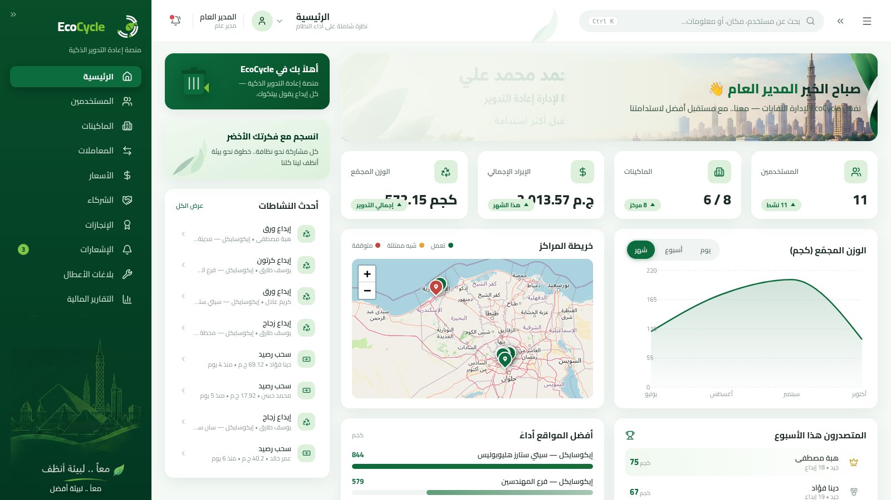
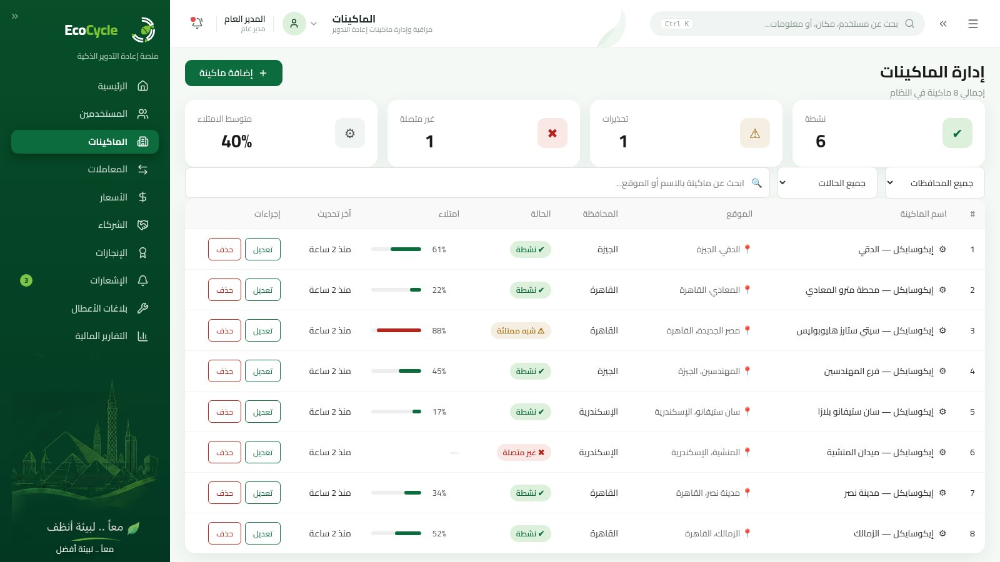
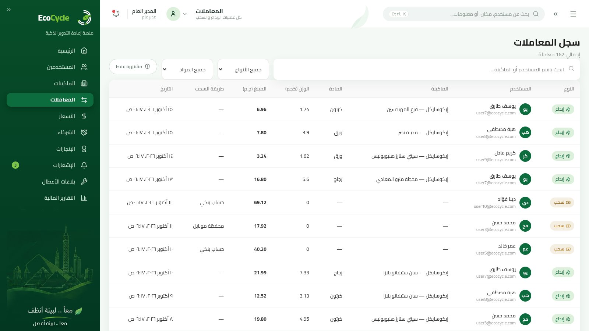
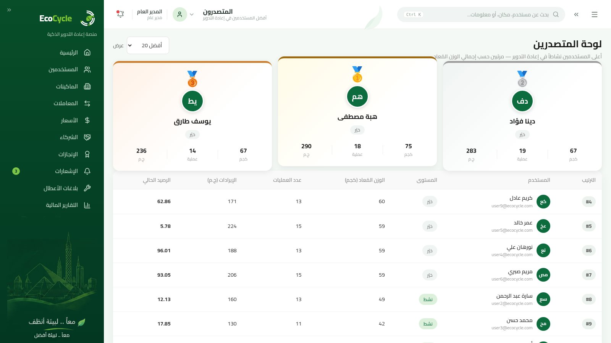
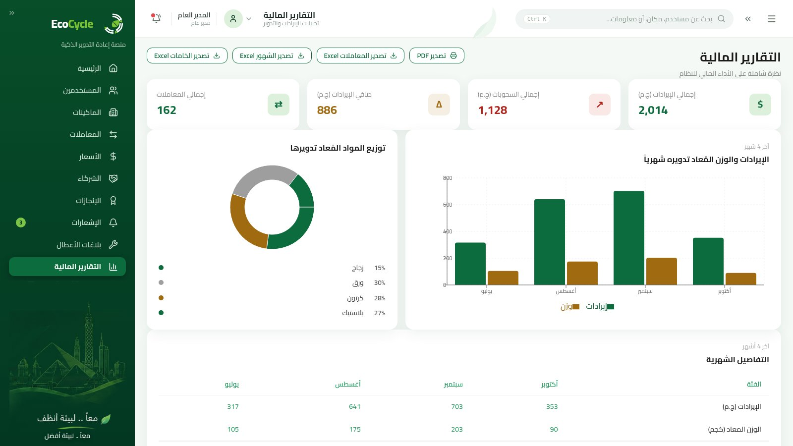
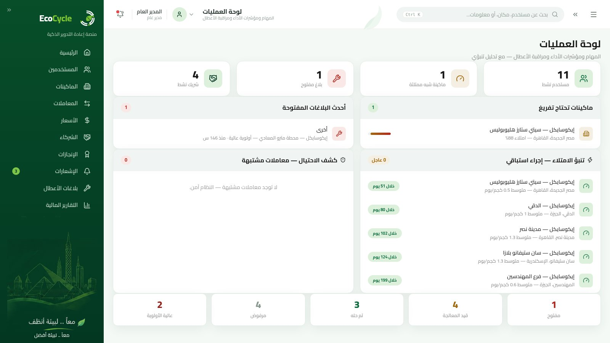
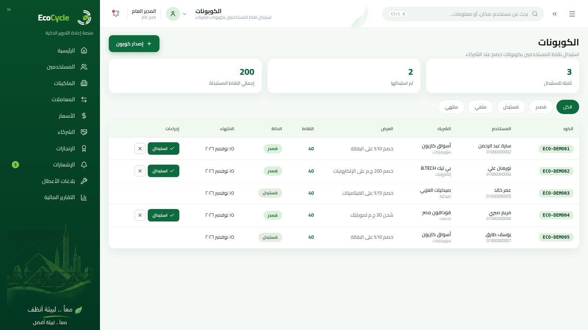
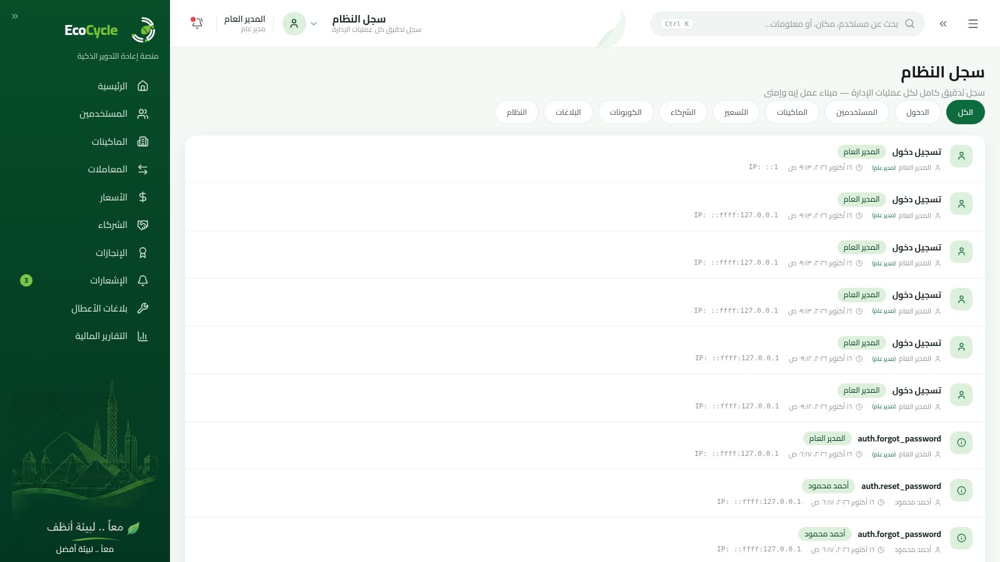
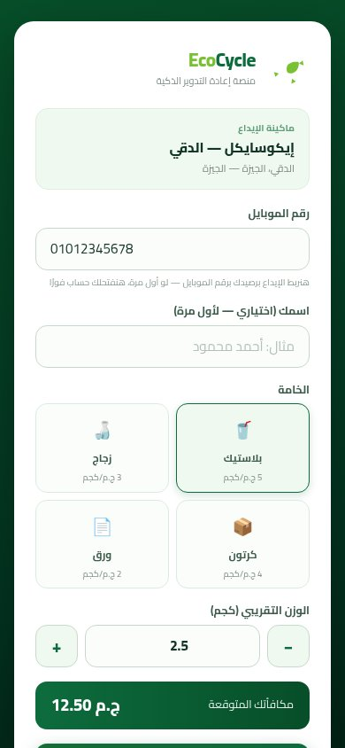

<div align="center">

# ♻️ EcoCycle — Smart Waste Recycling Platform

**منصة إعادة تدوير المخلفات الذكية** — Graduation Project · Digilians LAB 3 · Mohammed Jameel Fouad

[](https://nodejs.org)
[](https://expressjs.com)
[](https://react.dev)
[](https://www.mongodb.com)
[](Backend/tests)
[](LICENSE)

*A full-stack Arabic-first (RTL) platform that closes the recycling loop: smart machines → QR deposits → wallet rewards → partner coupons — with fraud detection, fill forecasting, audit logging, and real Excel/PDF reporting.*

</div>

---

## 🇪🇬 بالعربي — ملخص سريع

منصة **EcoCycle** بتوصل المواطن بماكينات إعادة التدوير الذكية: بيمسح كود QR من الماكينة، يدخل رقم موبايله من صفحة ويب على تليفونه، ويوصلله رصيد فوري مقابل الخامات اللي أودعها. الرصيد ده بيستبدله **كوبونات خصم** عند شركا المحلات والسوبر ماركت — وبكده حلقة الاقتصاد الدائري بتكتمل من أول الاختيار لحد المكافأة.

المنصة فيها **3 أدوار**: مدير عام (Super Admin)، مدير عمليات (Operations Manager)، ومستخدم عادي — وكل واحد ليهم لوحة وصلاحيات مختلفة (RBAC).

```bash
# تشغيل سريع (لازم MongoDB شغال على 27017)
cd Backend  && npm install && cp .env.example .env && npm run seed && npm run dev
cd Frontend && npm install && npm run dev    # http://localhost:5173
```

| حساب تجريبي | البريد | كلمة المرور |
|---|---|---|
| مدير عام | `admin@ecocycle.com` | `admin123456` |
| مدير عمليات | `ops@ecocycle.com` | `ops123456` |
| مستخدم | `user1@ecocycle.com` | `user123456` |

---

## ✨ Key Features

### 🔐 Security & Identity
- **JWT access tokens (15 min) + refresh tokens in httpOnly cookies** with automatic rotation — refresh can never be used as access
- **Account lockout**: 5 failed attempts → 15-minute lock, with timing-attack mitigation (dummy bcrypt compare)
- **RBAC** with three roles: `superAdmin`, `operationsManager`, `user`
- Helmet (11 security headers) + custom Express-5-compatible **NoSQL injection sanitizer**
- Per-route **rate limiting** on all auth endpoints
- **"Remember me"** with real logic: 30-day refresh token vs. 1-day session cookie
- Full **audit log** of every admin mutation (create/update/delete) + dedicated system-log page
- Password reset flow with single-use 15-minute tokens signed by a dedicated secret

### ♻️ The Circular Economy Loop
- **QR deposit flow**: scan machine QR → public PWA page (`/deposit?t=...`) → enter phone number → instant balance (auto-creates first-time users)
- **Coupons**: users redeem wallet balance for partner discount coupons — atomic `$inc` with insufficient-balance guard, full financial ledger
- **Partner portal**: partners verify and honor redeemed coupons
- **Achievements engine**: auto-unlocks badges after every deposit, with XP rewards and notifications
- Anti-fraud guard: every QR token can be used exactly once

### 🧠 Operational Intelligence
- **Machine fill forecasting** (14-day moving average) — *"this machine will be full in ~X hours"* on the ops dashboard
- **Fraud detection**: 5 deposits / 15 min or 2 different governorates / 10 min → auto-flag + high-priority issue
- **Live map** of all machines (Leaflet + OpenStreetMap, no API key) with color-coded status pins

### 📊 Reports & DX
- Real **Excel exports** (exceljs) — transactions / monthly / materials / coupons, with proper Arabic text encoding
- Print-ready **PDF views** with full RTL support
- Live **Swagger UI** at `/api/docs` + complete **Postman collection**

### 🧪 Quality
- **32 automated tests** (`node --test` + supertest): auth, lockout, refresh rotation, atomic balance ops, coupons, stats, PWA deposit, fraud detection, remember-me, password reset, Arabic messages
- **Seed data validator** (`npm run validate:seed`) — 12-section integrity check (counts, uniqueness, referential integrity, **ledger accuracy to the cent**)
- **Live smoke suite** (`npm run smoke`) — 51 end-to-end checks against a running server
- Docker + docker-compose (mongo + backend + nginx frontend)

## 🖼️ Screenshots

| Login | Dashboard | Machines |
|:---:|:---:|:---:|
|  |  |  |

| Transactions | Leaderboard | Reports |
|:---:|:---:|:---:|
|  |  |  |

| Ops Dashboard | Coupons | Audit Logs |
|:---:|:---:|:---:|
|  |  |  |

**PWA deposit flow (mobile):** scan QR → enter phone & pick material → set weight → confirm

<p align="center"></p>

## 🛠️ Tech Stack

| Layer | Technologies |
|---|---|
| **Backend** | Node.js 24 · Express 5.2 · Mongoose 9.6 (MongoDB) · JWT (jsonwebtoken) · Joi 18 validation · bcrypt · helmet · express-rate-limit · exceljs · swagger-jsdoc |
| **Frontend** | React 19 · Vite 8 · CSS Modules · Recharts 3 · Leaflet (react-leaflet) · lucide-react · React Router 7 |
| **Infra** | Docker · docker-compose · nginx reverse proxy · Morgan logging |

## 🏗️ Architecture

```
eco-system-main/
├── Backend/
│   ├── app.js / server.js        # Express 5 + Helmet + Sanitizer + CORS + Swagger
│   ├── config/db.js              # MongoDB connection
│   ├── models/                   # 12 models (User, Admin, Machine, Transaction,
│   │                             #   Coupon, Partner, Pricing, Achievement, AuditLog, ...)
│   ├── controllers/              # 14 controllers + Joi validation schemas (Arabic messages)
│   ├── routes/                   # REST routes with RBAC (allowedTo) middleware
│   ├── middleware/               # verifyToken, allowedTo, validationSchema, asyncWrapper
│   ├── utils/                    # achievementEngine, fraudDetection, fillForecast,
│   │                             #   audit logger, JWT helpers (access/refresh/reset)
│   ├── scripts/                  # seed.js · validateSeed.js · liveSmoke.js
│   ├── tests/                    # 32 automated tests (node:test + supertest)
│   ├── Dockerfile
│   └── EcoCycle.postman_collection.json
├── Frontend/
│   ├── src/components/           # Sidebar/Navbar (approved design) + Leaflet map
│   │                             #   + dashboard widgets + full UI kit (Modal, Toast, ...)
│   ├── src/pages/                # 16 Arabic RTL pages (incl. Coupons, Audit Logs,
│   │                             #   PWA Deposit, Register, Forgot Password)
│   ├── src/services/             # API client with auto-refresh + file downloads
│   ├── src/context/              # AuthContext + ToastContext
│   ├── Dockerfile · nginx.conf
│   └── vite.config.js            # /api proxy → :4000
├── docs/screenshots/             # captured screens for this README
├── docker-compose.yml
├── LICENSE
└── README.md
```

## 🚀 Getting Started

### Prerequisites
- **Node.js 18+** (built and tested on 24)
- **MongoDB** running on `localhost:27017` (local install, Atlas URI, or the docker-compose service)

### Option 1 — Manual (development)

```bash
# 1) Backend
cd Backend
npm install
cp .env.example .env        # then edit secrets (see table below)
npm run seed                # full demo dataset (users, machines, transactions, coupons...)
npm run dev                 # http://localhost:4000 — API docs at /api/docs

# 2) Frontend (new terminal)
cd Frontend
npm install
npm run dev                 # http://localhost:5173 (proxies /api → :4000)
```

### Option 2 — Docker (production-style)

```bash
docker compose up -d        # frontend: http://localhost:8080 · API: http://localhost:4000/api/docs
```

### Environment variables (`Backend/.env`)

| Variable | Purpose | Default in `.env.example` |
|---|---|---|
| `PORT` | API port | `4000` |
| `NODE_ENV` | environment | `dev` |
| `MONGO_URI` | MongoDB connection | `mongodb://localhost:27017/ecocycle` |
| `JWT_SECRET` | access-token secret | — **set a strong random value** |
| `JWT_REFRESH_SECRET` | refresh-token secret | — **set a strong random value** |
| `JWT_RESET_SECRET` | password-reset secret | — **set a strong random value** |
| `ADMIN_EMAIL` / `ADMIN_PASSWORD` | super-admin created by seed | `admin@ecocycle.com` / `admin123456` |
| `TEST_MONGO_URI` | isolated DB for `npm test` | `mongodb://127.0.0.1:27017/ecocycle_test` |

> 🔒 Generate strong secrets with `openssl rand -hex 32`. Demo credentials are for development only — change them before any real deployment.

## 🧪 Testing & Verification

```bash
cd Backend
npm test              # 32/32 automated tests (uses an isolated test database)
npm run seed          # re-seed demo data
npm run validate:seed # 12-section seed integrity audit — ledger accurate to the cent
npm run smoke         # 51 live end-to-end checks (requires server running on :4000)
```

Coverage highlights: auth for all 3 roles · account lockout · refresh-token rotation & reuse protection · refresh-token-rejected-as-access · atomic deposit/withdraw/coupon redemption (no race conditions) · insufficient-balance safety · stats & leaderboard filters · public PWA deposit (auto account, one-time QR) · fraud rules · remember-me durations · password reset flow · Arabic error messages end-to-end.

## 📚 API Documentation

- **Swagger UI** (live): `http://localhost:4000/api/docs`
- **Postman collection**: [`Backend/EcoCycle.postman_collection.json`](Backend/EcoCycle.postman_collection.json)

## 📄 License

Released under the [MIT License](LICENSE) — © 2026 Mohammed Jameel Fouad.

---

<div align="center">

**Graduation Project** — Digilians LAB 3 · Mohammed Jameel Fouad

*"From waste to worth — closing the recycling loop in Egypt."* 🌿

</div>
